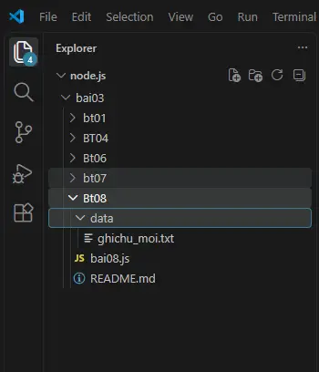
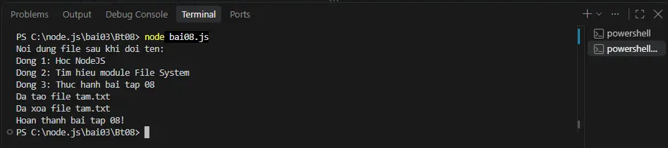
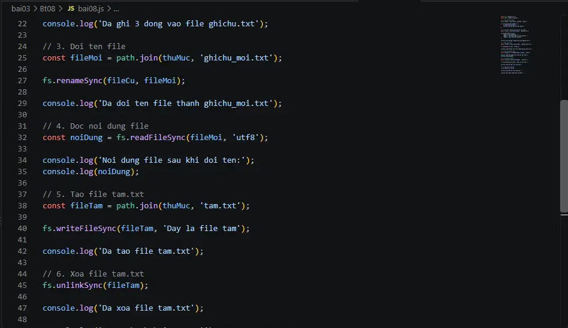

# BÀI 08: QUẢN LÝ TẬP TIN VỚI FILE SYSTEM

## 1. Giới thiệu
Sử dụng module fs trong Node.js để quản lý tập tin và thư mục.

## 2. Các chức năng thực hiện
- Tạo thư mục data.
- Tạo tập tin ghichu.txt.
- Ghi ít nhất 3 dòng nội dung.
- Đổi tên thành ghichu_moi.txt bằng fs.rename().
- Đọc và hiển thị nội dung tập tin.
- Tạo tập tin tam.txt.
- Xóa tập tin tam.txt bằng fs.unlink().
- Hiển thị thông báo kết quả từng thao tác.

## 3. Cách chạy chương trình

Mở Terminal tại thư mục Bt08.

Chạy lệnh:

`node bai08.js`

## 4. Kết quả
Chương trình chạy thành công, thực hiện đầy đủ các thao tác theo yêu cầu bài tập.

## 5. Cấu trúc thư mục
- bai08.js
- README.md
- data/
  - ghichu_moi.txt

## 6. Hình ảnh minh chứng
### Ảnh 1: Cấu trúc thư mục

### Ảnh 2: Kết quả chạy chương trình

### Ảnh 3: Code chương trình

