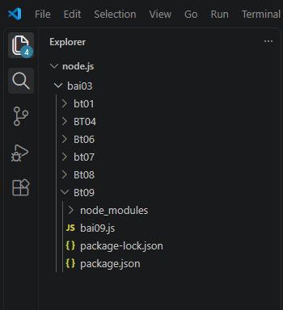
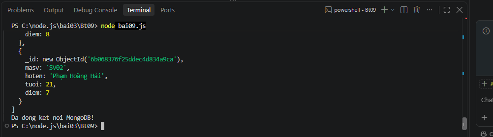
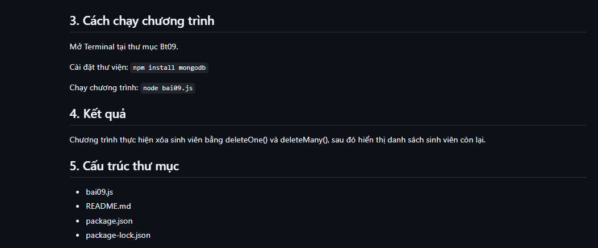

# BÀI 09: XÓA DỮ LIỆU SINH VIÊN TRONG MONGODB

## 1. Giới thiệu

Sử dụng Node.js và MongoDB để thực hiện xóa dữ liệu sinh viên có điều kiện.

## 2. Các chức năng thực hiện

- Kết nối database qlsinhvien.
- Sử dụng collection students_test.
- Thêm ít nhất 5 sinh viên mẫu.
- Sử dụng deleteOne() để xóa sinh viên theo mã sinh viên.
- Sử dụng deleteMany() để xóa các sinh viên có điểm dưới 5.
- Hiển thị số bản ghi đã xóa.
- Hiển thị danh sách sinh viên còn lại bằng find().

## 3. Cách chạy chương trình

Bước 1: Mở Visual Studio Code.

Bước 2: Mở thư mục Bt09.

Bước 3: Mở Terminal tại thư mục Bt09.

Bước 4: Cài đặt thư viện MongoDB Driver:

npm install mongodb

Bước 5: Chạy chương trình:

node bai09.js

Bước 6: Quan sát kết quả trong Terminal.

## 4. Kết quả

Chương trình kết nối MongoDB thành công.

Thêm 5 sinh viên mẫu vào database qlsinhvien, sử dụng deleteOne() để xóa sinh viên theo mã sinh viên, sử dụng deleteMany() để xóa các sinh viên có điểm dưới 5.

Chương trình hiển thị số bản ghi đã xóa và danh sách sinh viên còn lại bằng find().

## 5. Cấu trúc thư mục

Bt09 gồm các tập tin:

- bai09.js
- README.md
- anh1.png
- anh2.png
- anh3.png
- package.json
- package-lock.json

## 6. Hình ảnh minh chứng

### Ảnh 1: Code chương trình

### Ảnh 2: Kết quả chạy chương trình

### Ảnh 3: Cấu trúc thư mục

